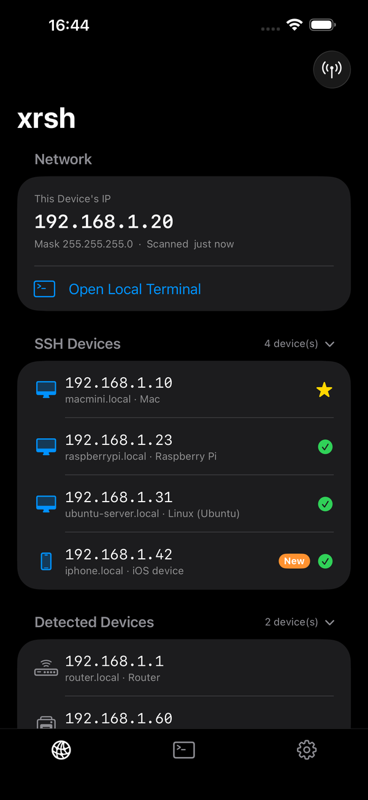
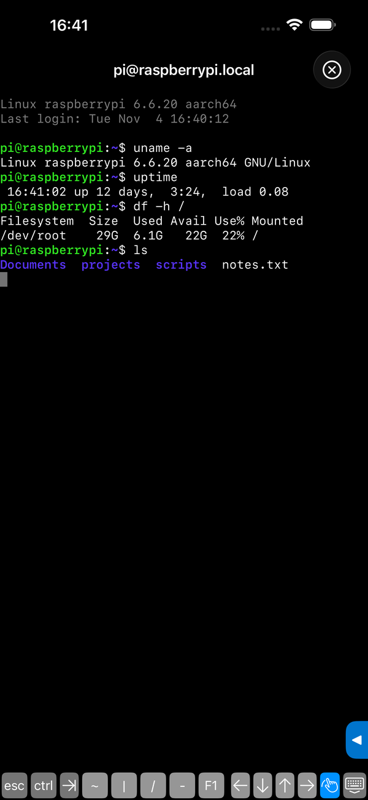
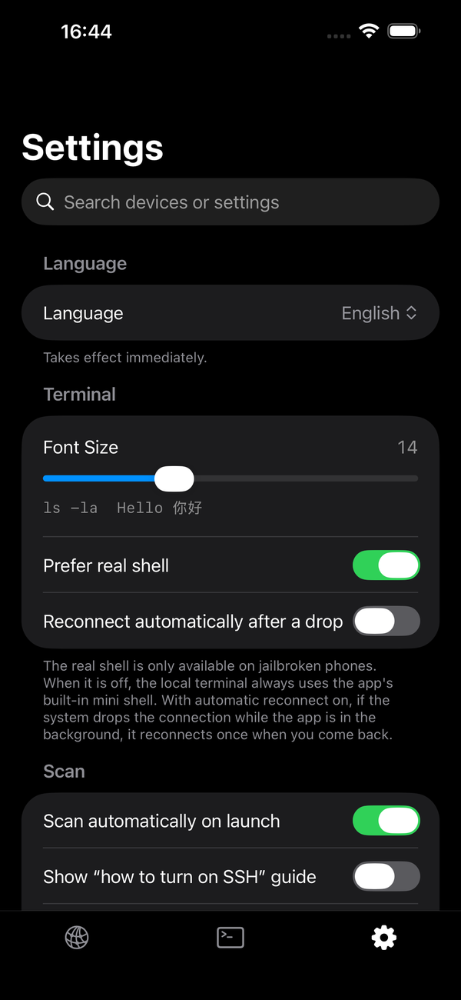

# xrsh

**A lightweight SSH client and LAN scanner for iOS** · [简体中文](README.zh-CN.md)

Scan your Wi‑Fi, tap a device, and you're in a terminal. xrsh finds SSH devices on your local network, connects with one tap, and comes with a terminal, SFTP file transfer and passwordless key login. TrollStore and jailbreak friendly (real shell on jailbroken devices).

  
  
  

SwiftUI, iOS 17+. The UI is in English, Chinese, Japanese and Russian (Japanese and Russian are new in 1.1; corrections are welcome). The screenshots use demo data.

## Features

**Devices**
- Scans the current subnet and splits results into *SSH devices* and *Detected devices*, with the device name and a guessed device type (Mac, Windows, Raspberry Pi, iPhone, router, …).
- Remembers the last scan; offline devices show "last seen X ago".
- Long‑press a device to name it, copy its IP or connect.
- Devices with passwordless login set up show a yellow star: tap once and you're in the terminal.
- Optional "how to turn on SSH" guide for devices that don't have SSH open.

**Terminal**
- SSH terminal built on [Citadel](https://github.com/orlandos-nl/Citadel) and [SwiftTerm](https://github.com/migueldeicaza/SwiftTerm). Password or key login; host keys are remembered on first connect and a changed key is rejected.
- Passwordless login: generates an ed25519 key, adds the public key to the device's `authorized_keys`, and stores the private key in the system Keychain only after a test login succeeds.
- Reopening the app after quitting reconnects to the device you were last using. Optional auto‑reconnect after the system drops a backgrounded connection.
- Local terminal: a real shell on jailbroken devices, otherwise a built‑in mini shell (with `curl`, `ping`, file and text commands).
- Command panel: plain‑language command suggestions and ~70 documented commands. Commands are only typed into the input line, never run automatically.
- File transfer over SFTP: browse, download and upload.

**AI assistant (new in 1.1, optional, off by default)**
- Type `/xr` in any terminal to talk to an AI right there, for example `/xr how much disk space is left?`. It can run commands on the connected device to get the job done.
- Bring your own OpenAI‑compatible API: you enter the address, model and key. The key stays in the Keychain on your phone.
- The app, not the AI, decides what runs: read‑only commands run on their own, anything that changes the device asks you y/n first, and destructive commands (wiping disks, rebooting) are blocked.
- What is sent to your API: what you type, the device name, the scanned device list, the recent terminal output (can be turned off in Settings) and the output of commands it runs. Things that look like passwords, keys and tokens are hidden first, but this is a best‑effort filter. Nothing is sent while the assistant is off.
- This is the first version. It is tested in the simulator and on one jailbroken iPhone, so treat it as experimental.

**Optional extras (new in 1.1, all off by default)**
- Enter tmux after SSH connects, so a dropped connection picks up where it left off (the device needs tmux installed).
- Device tools: long‑press a device to open its web page or wake it with Wake on LAN.
- Saved connections for devices you reach by address, plus a guide for reaching home devices from outside with Tailscale.

**Settings**
- Search (devices and settings together), language, terminal font size, auto‑scan, clearing saved passwords / keys / scan results, and switches for the features above.

## Install

Download `SSH.ipa` from the Releases page. There is only one file.

- **TrollStore / TrollStore Lite:** install it directly. On a jailbroken device the local terminal is a real shell.
- **AltStore, Sideloadly and other sideloading tools:** let the tool re‑sign it with your own Apple ID. Re‑signing removes the jailbreak‑only entitlements, so there is no real shell and the local terminal falls back to the built‑in mini shell. Everything else (scanning, SSH terminal, file transfer, passwordless login) works. I haven't verified every sideloading tool.

Your phone must be on the same Wi‑Fi as the devices you want to scan. On first launch, allow the Local Network permission, otherwise no devices can be found.

To build from source or package the jailbreak version yourself, see [BUILDING.md](BUILDING.md).

## License

Licensed under the [PolyForm Noncommercial License 1.0.0](LICENSE): free for personal study, research and other noncommercial use; commercial use is not allowed. Third‑party dependencies keep their own licenses, see `SSH/Licenses/`.
