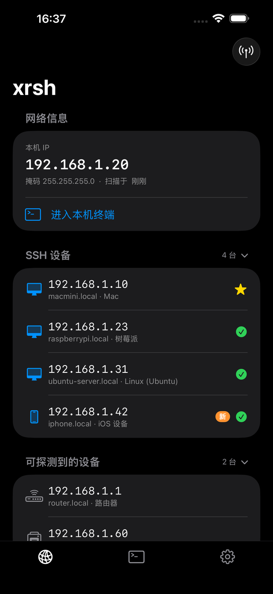
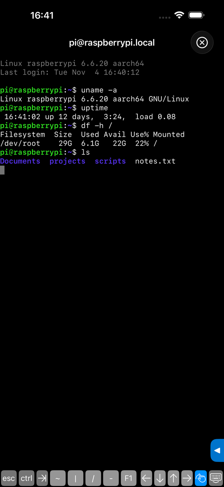
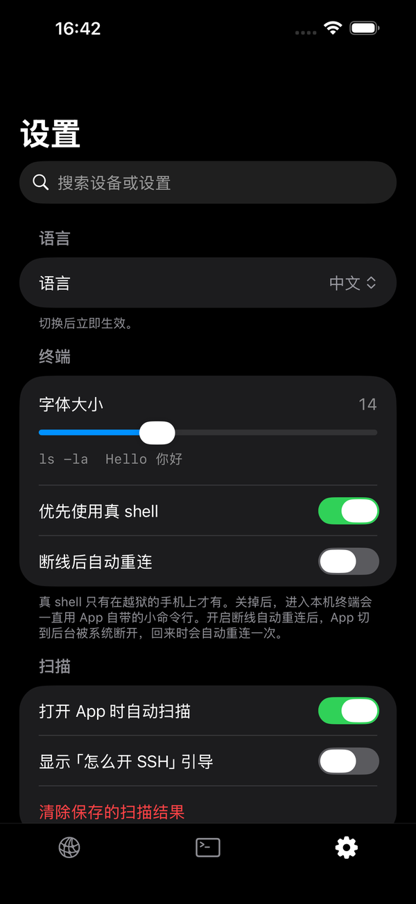

# xrsh

**iOS 上轻量的 SSH 终端与局域网设备扫描工具** · [English](README.md)

扫描 Wi‑Fi，点一下设备就进终端。xrsh 能找出局域网里的 SSH 设备，一键连接，自带终端、SFTP 传文件和免密登录。支持 TrollStore 和越狱环境（越狱后本机终端是真 shell）。

  
  
  

SwiftUI 编写，最低 iOS 17，界面有中文、英文、日语和俄语（日语和俄语是 1.1 新增的，欢迎指正）。截图使用的是演示数据。

## 功能

**设备页**
- 扫描当前网段，分成「SSH 设备」和「可探测到的设备」，显示设备名和推测的设备类型（Mac、Windows、树莓派、iPhone、路由器等）。
- 记住上次扫描结果，离线设备显示「上次在线 X 前」。
- 长按设备：起名、复制 IP、SSH 连接。
- 设置过免密登录的设备显示黄色星标，点一下直接进入终端。
- 可选：对没开 SSH 的设备，按类型显示「怎么开 SSH」的步骤。

**终端页**
- SSH 终端（[Citadel](https://github.com/orlandos-nl/Citadel) + [SwiftTerm](https://github.com/migueldeicaza/SwiftTerm)），支持密码和密钥登录，首次连接记住主机密钥，之后密钥变了会拒绝连接。
- 免密登录：一键生成 ed25519 密钥并写进对方的 `authorized_keys`，验证能用密钥登录后，才把私钥存进系统钥匙串。
- 大退后重新打开，自动接回上次连着的设备；可选的断线自动重连。
- 本机终端：越狱环境下是真 shell，否则是 App 自带的小命令行（含 `curl`、`ping`、文件和文本命令）。
- 常用命令面板：人话版命令和约 70 条命令的说明，命令只填进输入行，不会自动执行。
- 传文件：通过 SFTP 浏览对方文件夹、下载、上传。

**AI 助手（1.1 新增，可选，默认关闭）**
- 在任意终端里输入 `/xr` 就能直接和 AI 对话，比如 `/xr 看看磁盘还剩多少`。它可以在连着的设备上跑命令，帮你把事做完。
- 用你自己的 OpenAI 兼容接口：接口地址、模型名和 Key 都由你填，Key 只存在手机的钥匙串里。
- 跑什么由 App 决定，不由 AI 决定：只读命令自动运行，会改动设备的命令先问你 y/n，危险命令（格式化磁盘、重启等）直接禁止。
- 会发给你的接口的内容：你说的话、设备名、扫描到的设备列表、最近的终端输出（设置里可以关）和它跑过的命令的输出。像密码、密钥、token 的内容会先隐藏，但这只是尽力过滤。关着助手时不会发送任何内容。
- 这是第一版，只在模拟器和一台越狱 iPhone 上测过，请当作试验功能。

**可选功能（1.1 新增，默认都关）**
- SSH 连上后自动进入 tmux，断线重连能接回原来的内容（对方要装了 tmux）。
- 设备小工具：长按设备打开它的网页，或用网络唤醒叫醒它。
- 常用连接：保存手动填地址的设备；还有用 Tailscale 从外面连回家的说明。

**设置页**
- 搜索（设备和设置项一起搜）、语言、终端字体大小、自动扫描、清除密码 / 密钥 / 扫描结果，以及上面这些功能的开关。

## 下载安装

到 Releases 页面下载 `SSH.ipa`，只有这一个文件。

- **TrollStore / TrollStore Lite 用户**：直接用 TrollStore 安装。在越狱环境下，「进入本机终端」会是真 shell。
- **用 AltStore、Sideloadly 等侧载工具的用户**：让工具用你自己的 Apple ID 重新签名后安装。重新签名会去掉越狱用的特殊权限，所以没有真 shell，本机终端会用 App 自带的小命令行；其余功能（扫描、SSH 终端、传文件、免密登录）都能用。这条路径我没有在每个侧载工具上逐一验证过。

装好后，手机要和被扫描的设备连在同一个 Wi‑Fi，首次打开会请求「本地网络」权限，需要允许，否则扫描不到设备。

想自己编译或打越狱版 ipa，看 [BUILDING.md](BUILDING.md)。

## 许可

本项目使用 [PolyForm Noncommercial License 1.0.0](LICENSE)：可以用于个人学习、研究和其他非商业用途，不可用于商业用途。第三方依赖遵循它们各自的许可，见 `SSH/Licenses/`。
